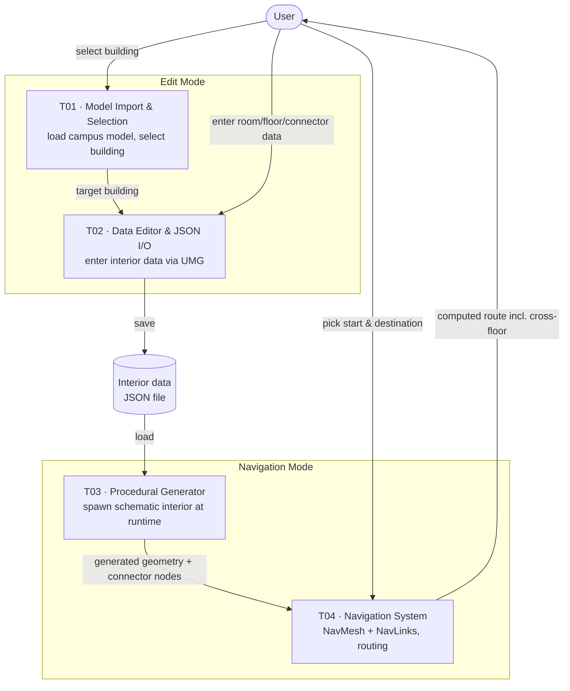

# System Architecture (v0.1)

> Team **Pathfinder** · Project **InNavi**
> Owned by: **Tech Lead.** This is the `Architecture v0.1` technical deliverable.
> Version 0.1 — expected to evolve as implementation progresses.

---

## 1. Overview

InNavi is a **standalone Unreal Engine runtime application**. Everything happens at
runtime, inside the packaged application — not in the UE editor:

1. The user loads the campus model and selects a building.
2. The user enters interior data (rooms, floors, connectors) through an in-app editor.
3. The data is saved/loaded as **JSON**.
4. The interior is **procedurally generated at runtime** from that JSON.
5. The user navigates the generated interior, including across floors.

The application has two runtime modes — an **Edit mode** (authoring interior data)
and a **Navigation mode** (walking/routing through the generated building).

## 2. Technology stack

| Concern | Choice | Reason |
|---------|--------|--------|
| Engine | Unreal Engine | Built-in rendering, runtime ray-casting/picking, navigation (NavMesh/NavLinks), and UI (UMG) |
| Core logic | **C++** | Performance and control for the core systems (generation, navigation) |
| UI & interaction | **Blueprint (UMG)** | Faster to build UI and simple interactions; lets UX members contribute to implementation. As of 2026-09-18, screens/dialogs/property panels are UMG, but most interior-editing tools are still bound to keyboard shortcuts pending a full toolbar pass — see `docs/design/interior-editor-guide.md` |
| Data format | **JSON** | Human-readable, easy to author, save, and reload interior layouts |
| Target platform | **Desktop first (M1)**, mobile later | Reduces risk for an M1 with a team new to UE; mobile targeted in M2/M3 _(platform scope pending confirmation with the professor)_ |

> Note: the full stack rationale is also recorded in the Toolchain Decision Document.

## 3. System modules

The system is built from the four technical deliverables (see `deliverables.md`),
each mapped to one product feature:

| Module | Deliverable | Feature | Responsibility |
|--------|-------------|---------|----------------|
| Model Import & Selection | T01 | F01 | Import campus model; runtime click/ray-cast to select a building |
| Building Data Editor & JSON I/O | T02 | F02 | UMG editor to enter interior data; save/load as JSON |
| Procedural Interior Generator | T03 | F03 | Read JSON; spawn schematic interior at runtime; record connectors as nodes |
| Indoor Navigation System | T04 | F04 | Runtime NavMesh + NavLinks; compute and display cross-floor routes |

## 4. Architecture diagram

## 5. Data flow

A single end-to-end cycle:

1. **Select** — user clicks a building (T01); the target building is passed on.
2. **Author** — user enters interior data in the UMG editor (T02): rooms, room types,
   floors, corridors, and connectors (elevators/stairs).
3. **Persist** — T02 serializes the data to a **JSON** file (and can reload it).
4. **Generate** — T03 reads the JSON and spawns the schematic interior at runtime
   (walls, doors, windows, corridors, stairs). Elevators/doors are recorded as
   **input/output nodes** describing connections between floors.
5. **Navigate** — T04 builds a runtime navigation graph from the generated geometry and
   those connector nodes (NavMesh + NavLinks). The user picks a start and destination;
   T04 computes and displays a route, including cross-floor transitions
   (e.g. L1 → elevator → L8 → target room).

The connector nodes produced in step 4 are the contract between generation (T03) and
navigation (T04): the generator must emit them consistently for routing to work.

## 6. Main technical risks

| Risk | Why it matters | Plan |
|------|----------------|------|
| School model import into UE | If the model does not import cleanly, nothing downstream works | Validate first, as soon as Parminder provides the model; confirm its format |
| Runtime dynamic NavMesh | Interior is generated at runtime, so the NavMesh must rebuild at runtime (not editor-baked) | Prototype on a simple two-floor test scene early, independent of the real model |
| Cross-floor routing via NavLinks | Vertical connections are the hard part of the navigation | Test NavLinks between floors on the same test scene |
| Mobile performance (later) | Runtime generation + pathfinding may be heavy on mobile | Deferred to M2/M3; desktop-first for M1 |

## 7. Component ownership

Ownership is tracked per deliverable in `deliverables.md`. As of 2026-09-18: T01–T03
(model import/selection, data editor & JSON, procedural interior generator) are owned
by Yongqi; T04 (indoor navigation) by ws/jh.
