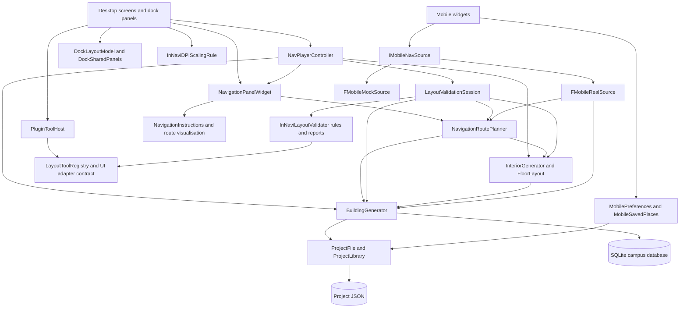

# System Architecture (v1.1)

> Team **Pathfinder** · Project **InNavi**
> Owned by: **Tech Lead.** This is the `Architecture` technical deliverable.
> Reviewed **2026-11-11**, against `main` through **c3e7755**. This revision reviews the implementation and commits after
> **422538f** (2026-11-05), the previous change to this page, and corrects older descriptions that no longer match the code.
> v0.1 (2026-09-30) described the proposed design; v0.2 (2026-10-23) described the implemented system;
> v1.0 (2026-10-28) introduced the layers and delivery model. v1.1 documents current project lifecycle, persistence,
> shared panels, responsive UI, validation execution, navigation/editor interactions, mobile audio and delivery safeguards.

## 1. Overview

InNavi is a **standalone Unreal Engine runtime application**, with a Windows desktop editor/navigation experience and an Android phone UI.
The application's layout editing and navigation run inside the packaged product. Unreal Editor is used for development and automation.
There is no application backend, shared online session or runtime network service for project data and routing.

The desktop flow is **start screen / project library → exterior campus screen → interior editor**. The exterior screen selects buildings
and plans campus routes; the interior screen edits floors on a 2D plan or in a 3D preview. Both screens expose navigation and shared tools.
The phone UI runs from the same codebase (`-MobileApp` previews it on desktop) and uses the real project-data adapter by default.

The campus is reconstructed from data rather than requiring one pre-modelled campus mesh. `BuildingGenerator` loads JSON projects or
SQLite campus footprints. Geographic coordinates are projected into a common local metre frame and scaled to Unreal centimetres.
`PolyBuilding` creates procedural building surfaces; roads and surrounding buildings are separate scenery actors. Database building heights
use default floor settings until authored data supplies more detail. `InteriorGenerator` creates rooms, openings and connectors from the
stored or currently edited interior. The result is a schematic layout, not a surveyed architectural model.

## 2. Technology stack

| Concern | Implementation |
| --- | --- |
| Engine and language | Unreal Engine 5.8; C++ |
| Runtime modules | Product module `InNavi`; reusable Runtime plugin `InNaviLayoutValidator` |
| Development-only module | `InNaviValidationTools`, an Editor module for headless file validation; excluded from packaged games |
| UI | UMG and Slate; current screen layouts are constructed in C++ through `RebuildWidget()`, with a custom dock system |
| Blueprint involvement | Existing `WBP_*` and test assets remain. The default `TestingMap` references the startup widget; core logic and native screen implementations are C++. The project is not Blueprint-free |
| Geometry | Runtime procedural mesh components for building/interior geometry; separate road and context-building actors |
| Storage | Versioned JSON projects and local preferences/layouts; SQLite campus database via SQLiteCore |
| Navigation | `FNavigationRoutePlanner`: visibility graph over actual boundaries, walls, openings and connectors, searched with Dijkstra; no Unreal NavMesh dependency |
| Package distribution | Native Unreal plugin distributed as an npm source package through GitHub Packages; compiled by UnrealBuildTool |
| Delivery | GitHub Actions; hosted Linux checks, self-hosted Windows Unreal builds/releases, self-hosted Linux wiki deployment |
| Documentation | Markdown under `docs/`, built with MkDocs |
| Targets | Windows desktop; Android ARM64 devices and x86_64 emulators |

[toolchain-decision.md](toolchain-decision.md) records technology-selection rationale; [configuration.md](configuration.md) records settings and their locations.

## 3. System components

| Component | Responsibility and main code |
| --- | --- |
| Campus / project data (T01, T02) | `BuildingGenerator`: JSON/SQLite loading, building identity/types, scenery and project serialization; `ProjectLibrary` and `ProjectFile`: file operations |
| Interior authoring and generation (T02, T03) | `InteriorGenerator`, `InteriorRoom`, `InteriorEntrance`, connector markers and `FloorLayout`; room/door/floor CRUD, geometry checks, generated floors, undo/redo and interior snapshots |
| Application session | `NavPlayerController`: active project/building, input tools, selections, dirty/file state, camera, inspection and audio; `NavGameMode` uses the shortcut-aware `NavCameraPawn` |
| Navigation (T04) | `NavigationPanelWidget` owns places, route jobs and guided steps; `NavigationRoutePlanner` owns routing; `NavigationInstructions` supplies shared guidance; dock UI and route visualisation present the results |
| Desktop UI | Start/project-library screens, `EditScreenWidget`, `InteriorScreenWidget`, dock host/model, shared panels and responsive DPI rule |
| Validation | Plugin supplies JSON/data/geometry rules and tool registration; product `LayoutValidationSession` supplies snapshots, navigation diagnostics, report lifecycle, focus and export |
| Mobile | `Mobile*Widget` screens consume `IMobileNavSource`; `FMobileRealSource` adapts project data and campus routing, while `FMobileMockSource` retains the prototype |

## 4. Responsibilities and dependencies

The following are **responsibility groups**, not a strictly enforced one-way import hierarchy. In particular, the mobile data adapter calls
the planner, the planner reads generator geometry, and some UI/controller code coordinates serialization and local files. A diagram arrow
means **uses or coordinates**, not exclusive ownership. The folder `InNavi/Source/InNavi/` is mostly flat.

The reusable plugin does **not** depend on `InteriorGenerator`, game actors or UnrealEd. The product captures data and combines plugin
findings with its own routing diagnostics. Its standalone consumer demonstrates data/geometry validation without the product. Another
Unreal project must provide compatible layout JSON and its own navigation/UI integration; the complete InNavi panel is not a universal
room validator for arbitrary games. `PluginToolHost` discovers providers through `LayoutToolRegistry`; `[InNavi.ToolPanels]` chooses the
product's panel adapter. See [the validator design](design/layout-validator.md) and the plugin's README/examples.

### 4.1 Desktop state, docking and responsive presentation

Each editor screen keeps its own layout file. `DockSharedPanels` transfers the shared **Audio, Map, Debug, Navigation and Validation**
placements between screens within the application session. Visibility, docking/floating and geometry follow the user. Containers made
entirely of shared panels transfer their full split/tab tree, order and ratios; shared panels mixed with screen-specific panels transfer
individually. Screens publish state on layout/menu changes and when leaving, then apply it after loading their own layout.

`UInNaviDPIScalingRule`, selected by `DefaultEngine.ini`, fits the desktop's 1920×1080 design to both viewport dimensions:
`max(0.01, 0.77 × min(width / 1920, height / 1080))`. At 1080p the reference scale remains 0.77. Android/iOS and desktop `-MobileApp`
retain 0.77 and the phone-specific layout; invalid/zero viewport sizes use the reference scale. `StartStyle::DesignToUi` converts design
pixels to UI units. Dock calculations use UI-space sizes, and clamp the computed floating-window rectangles inside the workspace without
overwriting the saved placement, allowing a larger window to restore the user's arrangement. This covers menus, dialogs and the library
as well as the editor screens (`DesktopResponsiveTests`).

Start and project-library screens register full-window pointer coverage through `SetPointerOverUICallback` and own a keyboard-shortcut
block. The controller drops shortcut key presses while these screens cover the scene, while allowing releases and mouse events through.
Mouse tools and navigation picking are mutually exclusive via `ExitAllMouseTools` / `CancelNavigationPicking`. `NavCameraPawn` avoids
Ctrl-descent conflicts and suppresses movement while Ctrl shortcuts are held. Input and drawing state belong to the controller, not the
particular dock panel currently showing them.

Returning to Start after the save/discard decision calls `CloseProject`. The shared `ClearProjectState` path removes buildings, scenery,
loaded interiors/history, selections, navigation places/routes, file/dirty state and copied room/building data. A new project uses the same
cleanup path, preventing the previous project or clipboard from leaking into the next session.

### 4.2 Editing and 3D inspection

`InteriorFloorPlanWidget` handles plan-space gestures; geometry mutations go through controller/generator operations with boundary,
overlap, opening and connector checks. Prefabs support click defaults and drag-sized previews. Resize handles anchor the opposite side,
update an outline during movement and commit the mesh once on release, with one undo step. Straight walls preserve their zero axis.
Width/length fields retain exact unedited dimensions rather than applying their rounded display values. Invalid Enter commits retain text
and focus; successful commits release focus; invalid blur commits restore dimensions. Invalid size does not discard pending name/tag/type
changes. Drawing checks each added segment; constraint failures clear the draft and publish a reason, while stray outside clicks preserve
it. Simple wall loops are permitted; crossings and retracing are rejected. See [the editor guide](design/interior-editor-guide.md) for controls and units.

`InteriorBuildingPreviewPivot` and controller inspection code implement Isolate & Rotate: temporarily transform the building, interiors,
connectors and route graphics together around the base pivot. Inspection suppresses editing and restores camera, floor and visibility
state afterward. The inspection transform does not change persisted layout coordinates. Navigation disables building see-through while
presenting the route.

### 4.3 Navigation and scheduling

`NavigationPanelWidget` is application state despite its name; `NavigationDockPanelWidget` is its view. Adding a stop appends a new
final destination and makes the old destination the preceding stop; routes with additional places number every row after Start.
Each place combo combines search and selection, retains its query through option refreshes, and supports keyboard and mouse selection.
Start/destination picking remains active until toggled off or replaced by another mouse tool.

The planner uses walls/openings, walkable representative room destinations, grouped floor connectors and main/link entrances, including
link-floor elevation checks. Private/key-required room restrictions and connector preferences apply. Layout revisions invalidate active
routes and cached graph data; moved endpoints refresh and unavailable/deleted stops are exposed for correction rather than silently
substituted. `NavigationInstructions` keeps desktop and mobile distance/turn/door/building/floor wording consistent.

The reusable campus graph is keyed by geometry, doors, connectors, entrances, scale and routing preferences. It is shared between route
legs and validation until inputs change. Pairwise graph joining uses parallel work over geometry data; it does not turn the entire route
request into an asynchronous actor operation. Desktop route jobs advance in budgeted game-thread slices with progress and cancellation;
mobile `BeginRoute` jobs are also advanced across frames and superseded requests are cancelled. Synchronous route APIs remain available
for tests and command-line consumers. Initial graph construction, loading and generation can still cause noticeable latency.

### 4.4 Validation execution and object lifetime

A controller-owned `LayoutValidationSession` shares one report between the two screens. `StartValidate` captures detached JSON including
applied unsaved interior edits, then runs plugin data/geometry checks on the thread pool with an atomic cancellation flag. Workers do not
read live UObjects. If those checks pass, product `FNavigationLayoutCheck` performs entrance-based reachability using the campus graph in
budgeted game-thread steps driven by the core ticker. The synchronous `Validate` entry point remains available.

Changing/closing the project invalidates an in-flight run; navigation is reported skipped and the result stale. Cancel/destruction signals
the worker and stops the ticker/job; cancellation leaves no completed report. Fingerprints/revisions detect stale completed reports;
stale reports cannot focus old objects or be exported. `Show on plan` explicitly navigates to an issue; export writes a unique JSON report
under `Saved/Validation/`. Validation is advisory and never auto-repairs the layout or blocks saving. Reachability means one tested room
destination is reachable from an exterior entry, not physical accessibility certification.

Slate references do not root UObjects. `LayoutValidationPanelWidget` therefore retains generated combo-item widgets through UPROPERTY
references (a bounded newest-item list), matching the other combo implementations. Painting tests exercise actual preview draw elements;
rendered tests cover native input/focus separately from headless state tests.

### 4.5 Mobile data and audio

`IMobileNavSource` isolates the screens from site storage and route construction. Real data is the default; `-MobileMock` explicitly
selects prototype data, and missing real data does not silently substitute mock routes. `-MobileProject=` overrides the editor snapshot;
otherwise an editor preview can use current applied unsaved data, or the adapter scans shipped `Data/` and local `Saved/MobileProjects/`
projects. Filename-based site identity and site/building/floor/room IDs prevent cross-project collisions. The adapter caches detached
snapshots and owns private routing worlds; browsing another site does not switch the editor's active building. Preferences and saved
places are local app state, with failed writes reported and in-memory changes rolled back; unavailable saved places can be removed.

`NavPlayerController` owns short-effect enable flags, playback and master volume. Error feedback binds `OnActionFailed` in `BeginPlay`
and unbinds in `EndPlay`; Error Sound is independent and included in Mute All. Controller mute state survives screen replacement. The
phone plays effects on **Start navigation**, **Next instruction** and **I have arrived**; **Get directions** only opens the planned route.
Profile volume updates playback and persists in `MobilePreferences.json`. `WavFileLoader` validates chunks and bounds file reads to 64 MiB.

## 5. Project data flow and persistence

1. **Open:** JSON or SQLite is staged and checked before replacing the live project. Failed imports preserve current data and save destination.
2. **Load/generate:** `BuildingGenerator` owns campus footprints/types and scenery. `InteriorGenerator` loads one active building's interior;
   other buildings retain stored interior snapshots. Floors/rooms/openings/connectors produce runtime geometry and routing inputs.
3. **Edit:** Commands update live state and undo/redo history; applied unsaved data is visible to navigation, validation and mobile preview.
4. **Save / Save As:** The active interior and campus state serialize to JSON. Plain projects write format **1**; projects with map scenery
   write format **2**, the highest currently supported format. Version 2 preserves `buildingType`, `contextBuildings` and `roads`.
   POI spheres are no longer created and old `pois` arrays are ignored. A database project initially has no JSON save path.
5. **Navigate / validate:** Both consume the current applied state; edits invalidate routes, caches and validation snapshots.
6. **Close:** Save/discard is resolved before project state is cleared. Window-close handling also protects unsaved work.

`ProjectFile::FMutationLock` coordinates desktop save/rename/trash mutations using a system-wide critical section. `ProjectFile::WriteText`
writes and closes a unique sibling temporary file in UTF-8 before replacement; failed publication preserves the previous destination.
No-replacement moves avoid overwriting another project. `ProjectLibrary` and the generator use these helpers; stale/missing source-file
checks prevent overwriting a file changed outside the session. Newer-format input is preserved by saving to a compatible copy instead of
silently overwriting it. Save dialogs start in `Data/`. These are local-file protections, not a collaborative database transaction system.

See [the project-file format](design/project-file-format.md), [its schema](schemas/project.schema.json) and `ProjectFile.h/.cpp` for format and write contracts. Older projects
remain supported, including sparse authored floor levels; supported floor counts/levels are bounded to 200. Navigation/validation object
identity uses scoped IDs, with duplicate door/connector/mobile-place conflicts repaired or diagnosed by the relevant loader/validator.

## 6. Performance and remaining risks

[performance.md](performance.md) records **dated measurements**, machines and reproduction commands; they are not new measurements for this document
revision. Its historical campus load figure included POI markers that the current renderer no longer spawns. Do not treat that old object
count as the current scene composition. Automation writes fresh measurements to `Saved/Performance/` when run.

| Concern | Current design and evidence |
| --- | --- |
| Initial campus load / interior generation | SQLite/JSON loading and procedural geometry remain local work and can hitch; performance tests cover campus load, interior open/generation and validation on representative data |
| Cold route graph | Pairwise joining still scales roughly quadratically with graph vertices. Parallel joining and graph reuse reduce cost but do not remove the cold-build wait. Historical desktop measurements after the 2026-10-31 optimisation were about 0.9 s cold and 20 ms cached; results vary by machine and layout |
| Stale routes and validation | Revisions, detached snapshots, cancellation and stale-report guards prevent outdated results from being used after edits; there is no live multi-user synchronisation |
| Real-data mobile performance | `performance.md` records a 2026-10-31 Galaxy S24+ Development build on real projects at the 60 FPS cap across tested scenarios, with one 121 ms first-route frame. This is device/build-specific evidence, not a measurement of every later APK |
| Imported layout quality | Geometry and scoped IDs are checked; unavailable route candidates and missing exterior entries are reported explicitly. The database does not supply authored room interiors automatically |
| UI lifetime and resizing | UPROPERTY-owned generated widgets, paint-path tests, responsive DPI sizing and bounded floating rectangles address the observed crash and off-screen-panel failure modes |

`[RouteTiming]` records work/wait time, graph size and cache reuse per route leg. See `NavigationInvalidationTests`, `RobustnessTests`,
`DatabaseProjectTests`, `DesktopResponsiveTests`, `EditorFeedbackTests` and `LayoutValidationTests` for the associated regression coverage.

## 7. Delivery and verification

| Work | Trigger, runner and safeguards |
| --- | --- |
| Hosted checks | Pull requests and pushes to `main`: `lint.yml` and `validate-json.yml` check repository content, schema/data cases and publishing-script tests; PRs do not run the self-hosted Unreal build |
| Unreal build / analysis / automation | `build-windows.yml` on `main` pushes or eligible manual runs; self-hosted Windows. Clean-checkout Development editor build with adaptive unity disabled; MSVC analysis checked for product warnings/errors; all `InNavi.*` editor-context tests run with `-nullrhi` and their report is checked for failures/incomplete runs |
| Windows release | Milestone tags or manual tag selection. Hosted verification checks tag syntax and ancestry on `main`; Windows checks out the exact verified commit, packages/cooks, starts the package for a smoke test and publishes it |
| Release asset protection | `package-windows.ps1` verifies ZIP contents, uses Explorer-compatible top-level entry names (no `./` entries), and `publish-release.ps1` protects the previous download until replacement checks succeed. Runner scripts use `cmd` and explicit PowerShell execution-policy bypass |
| Plugin package | `publish-layout-validator.yml` publishes a matching versioned source package to GitHub Packages, resolves the consumer pin/lock and verifies its source; native code is built by UnrealBuildTool |
| Wiki | `deploy-wiki.yml` runs on `main` documentation/configuration changes or a manual run, on the self-hosted Linux wiki runner. MkDocs builds to staging; `publish-wiki.py` swaps directories when possible and otherwise replaces contents inside the writable web root |

The checked-in plugin descriptor/package are **1.1.1**; the root consumer dependency/lockfile still pin **1.0.0**. Build/release checks use
`install-layout-validator.mjs --check --allow-unreleased`: matching versions must match installed package source; a newer checked-in
version is permitted before publication. This distinction does not assert that 1.1.1 has been published. Package access uses CI credentials.

Headless CI checks state and preview draw-element generation, but rendered input tests (`InNavi.EditorUX.Rendered.*`) explicitly require
an additional run **without `-nullrhi`**. Client-context live-audio checks require `-game` and audio enabled. The default headless editor run
does not prove native focus handling or audible playback. Documentation changes need lint, local-link and site-build verification rather
than rebuilding the C++ application. Test counts and performance results should be taken from the run's report, not inferred from this page.

Runtime configuration lives in `InNavi/Config`, shipped data in `InNavi/Data`, and writable app data under `Saved/`. No project-data backend
or runtime authentication is required; build/package credentials and Android signing keys are separate delivery concerns. Detailed settings
and wiki access are in [configuration.md](configuration.md); Android installation/signing are in [android-install.md](android-install.md) and [android-signing.md](android-signing.md).

## 8. Component ownership

Accountable owners follow [deliverables.md](deliverables.md); the table below retains the recorded ownership allocation.
Contributions and fixes can cross these boundaries and do not reassign ownership.

| Component | Layer | Owner |
|-----------|-------|-------|
| Model import and building selection (T01), data editor and JSON (T02: the data model and the dialogs) | 1, 2, 3, 4 | Yongqi |
| Procedural interior generator (T03) | 3 | Afiq (owner of the epic in Jira) |
| The editor's on-screen toolbar (T02, UI layer) | 1 | Padre |
| User input to JSON conversion (T02) | 4 | Afiq |
| Dock system, the shared panels, the interior and exterior screens | 1, 2 | Yongqi |
| Indoor navigation (T04): the planner, doors between buildings, campus routing | 3 | ws / jh |
| Navigation panel (places list, Plan and Go) and the step-by-step view | 1, 2 | Yongqi, on ws / jh's multi-stop work |
| Layout validator plugin and its package | 3 | ws |
| Phone app screens (the `Mobile*Widget` UI) and the Android build and signing | 1 | Yongqi |
| Phone data interface (`IMobileNavSource` and its sources) | 4 | ws |
| CI/CD, release build, wiki | - | Yongqi |
