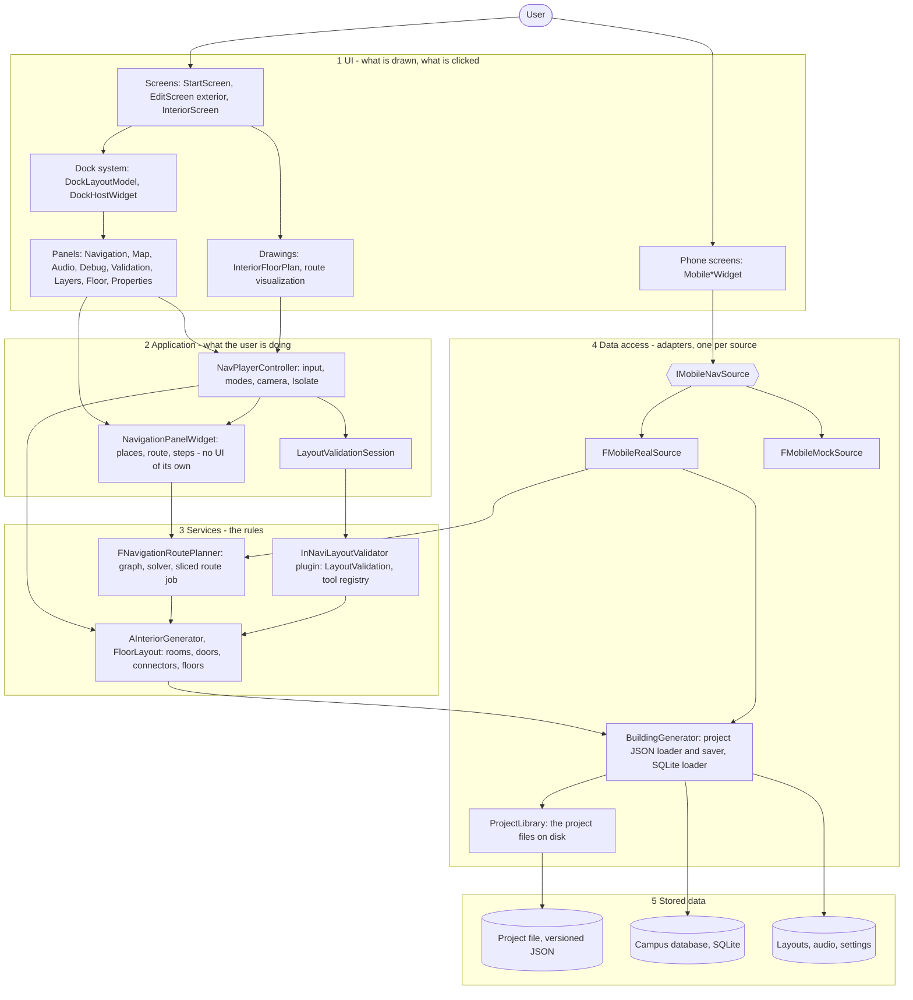

# System Architecture (v1.0)

> Team **Pathfinder** · Project **InNavi**
> Owned by: **Tech Lead.** This is the `Architecture` technical deliverable.
> v0.1 (2026-09-30) was the design before implementation. v0.2 (2026-10-23) brought it in line with what was built. **v1.0 (2026-10-28)**
> adds the **layers** (section 4), the boundaries between them and who owns each (sections 4 and 8), the delivery pipeline (section 7), and
> the measured numbers behind the risks (section 6). It describes the code as it is on `main`; when the code changes, this page changes with it.

---

## 1. Overview

InNavi is a **standalone Unreal Engine runtime application**. Everything happens at
runtime, inside the packaged application — not in the UE editor:

1. The user loads the campus model and selects a building.
2. The user enters interior data (rooms, floors, connectors, doors in the outer wall) through an in-app editor, or has a floor generated.
3. The data is saved/loaded as **JSON** (a project file that carries its format version; every field is in `design/project-file-format.md` and in the JSON Schema `schemas/project.schema.json`, which CI and the tests check).
4. The interior is **procedurally generated at runtime** from that JSON.
5. The user navigates: inside the building, across floors, between buildings (over link doors, or out through main doors and back in)
   and across the open ground between them, through any number of stops, one step at a time.

The desktop application has two screens: the **exterior screen** (the campus in 3D, where a building is selected and routes
between buildings can be planned) and the **interior editor** (a building's floors in 2D, or a 3D preview, where interior data is
authored and routes inside it are planned). A separate **Android phone app** shows the same places and routes on a phone.

## 2. Technology stack

One technology for each concern; this table is what every other document names.

| Concern | Choice |
|---------|--------|
| Engine | Unreal Engine 5.8 |
| Core logic | C++ (one module, `InNavi`, and one plugin, `InNaviLayoutValidator`) |
| UI & interaction | UMG, built entirely in pure C++ (`RebuildWidget()`), not the Blueprint Widget Designer; our own dock system for the panels |
| Data format | JSON (project files: buildings, interiors, doors), SQLite (real-world campus data - a second, additional loading path) |
| Route finding | Our own planner (`FNavigationRoutePlanner`): a visibility graph over the real wall, door and connector geometry, searched with Dijkstra. Not Unreal's NavMesh |
| Packages | The layout validator is an Unreal plugin, published as a versioned source package to GitHub Packages (npm) and installed by exact version |
| CI/CD | GitHub Actions: a self-hosted Windows runner (build, static analysis, tests, release package) and GitHub-hosted / VM runners (lint, JSON check, wiki) |
| Documentation | Markdown in `docs/`, published as a MkDocs site (the team wiki) |
| Target platform | Windows desktop (the editor and the desktop app); Android phones (the phone app, 64-bit ARM, plus x86_64 for PC emulators) |

> Full rationale for each of these - and for libraries/plugins and AI tools, which
> this table leaves out - is recorded in `toolchain-decision.md`, not duplicated here.

## 3. System modules

The system is built from the four technical deliverables (see `deliverables.md`),
each mapped to one product feature, plus the phone app that reads their data:

| Module | Deliverable | Feature | Responsibility |
|--------|-------------|---------|----------------|
| Model Import & Selection | T01 | F01 | Import campus model; runtime click/ray-cast to select a building |
| Building Data Editor & JSON I/O | T02 | F02 | UMG editor to enter interior data (2D plan, 3D preview, doors, floor generator); dockable panels; save/load as JSON |
| Procedural Interior Generator | T03 | F03 | Read JSON; spawn schematic interior at runtime; record connectors as nodes |
| Indoor Navigation System | T04 | F04 | Plan routes (through stops) over the generated geometry, across floors, between buildings and outdoors; show them as numbered steps, one step at a time, and on the 2D and 3D maps |
| Layout Validator (plugin) | - | - | Read-only checks of a project's data, geometry, doors, connectors and reachability; a reusable package |
| Phone app | T04 stretch | - | Android screens (Explore, Directory, Saved, Profile) over one data interface, `IMobileNavSource`; on cached project data and campus routes; `-MobileMock` retains the prototype |

## 4. Layers

The code is in five layers. A layer uses the one below it and never one above it, and a UI class never decides what a route is, nor
reads a file. This is the rule that code review checks, and the folder is flat (`InNavi/Source/InNavi/`), so the layers are named here.

| Layer | What is in it (`InNavi/Source/InNavi/`) | May use |
|-------|-----------------------------------------|---------|
| 1 UI | `StartScreenWidget`, `EditScreenWidget`, `InteriorScreenWidget`; `DockLayoutModel`, `DockHostWidget` and the panels (`NavigationDockPanelWidget`, `MapPanelWidget`, `AudioPanelWidget`, `DebugPanelWidget`, `LayoutValidationPanelWidget`); `InteriorFloorPlanWidget`; `NavigationRouteVisualization`; the `Mobile*Widget` screens | layers 2 and 3 through the controller and the data interface |
| 2 Application | `NavPlayerController` (input, modes, camera), `NavigationPanelWidget` (the places, the route and its steps; no UI of its own), `LayoutValidationSession`, `PluginToolHost` | layer 3 |
| 3 Services | `NavigationRoutePlanner` (graph, solver, the route job that runs a little each frame), `InteriorGenerator`, `FloorLayout` (pure geometry), the `InNaviLayoutValidator` plugin (`LayoutValidation`, `LayoutToolRegistry`) | layer 4 |
| 4 Data access | `BuildingGenerator` (project file and database loaders and the saver), `ProjectLibrary`, `IMobileNavSource` with `FMobileRealSource` and `FMobileMockSource` | layer 5 |
| 5 Stored data | the project JSON files, `map_extended.db`, the dock layouts, the audio files | - |

**The boundary.** The product is one process on one machine: there is **no server and no network call**, so what other products call
"the API" is, here, **the interface between the UI and the layers below it**:

- For the phone app that interface is `IMobileNavSource` (sites, buildings, places, floor plans, routes). It has two implementations
  (the real project data and the prototype's mock data) and a contract test that every implementation must pass (`MobileNavSourceContract`),
  so a screen can be tested against either and a third source could be added without touching a screen.
- For tools the interface is `LayoutToolRegistry` in the plugin, through which the editor discovers the validator's menu and panel.
- The desktop screens reach the services through `NavPlayerController` and `NavigationPanelWidget`, never directly.

**Data adapters.** Each source of data has exactly one adapter that turns it into the common form the services use: the project JSON
and the campus database are read by `BuildingGenerator`; the phone app reads through `FMobileRealSource`. A new source (a different
campus database, a live feed) is a new adapter; the planner and the screens do not change.

## 5. Data flow

A single end-to-end cycle:

1. **Select** — user clicks a building (T01); the target building is passed on.
2. **Author** — user enters interior data in the UMG editor (T02): rooms, room types,
   floors, corridors, connectors (elevators/stairs/escalators) and doors in the outer wall
   (main doors, and link doors to the building next door) - or fills a floor with a generated layout.
3. **Persist** — T02 serializes the data to a **JSON** project file (and can reload it).
4. **Generate** — T03 reads the JSON and spawns the schematic interior at runtime
   (walls, doors, corridors, stairs). Elevators/doors are recorded as
   **input/output nodes** describing connections between floors.
5. **Navigate** — T04 builds a visibility graph from the geometry, the connector nodes and the doors in
   the outer walls, and searches it. The user sets a list of places (a room, a building's main door,
   or a point on the floor plan or the ground; the first is the Start, the last the Destination, any between are stops); T04 computes
   the route leg by leg - including floor changes, link doors between buildings and the open ground - and shows it as numbered steps
   and on the maps, one step at a time, with the view (and the screen: inside, outside, inside) following the step.
   (e.g. L1 → elevator → L8 → target room; or building A → link door → building B → stairs → floor 3).

The connector nodes and doors produced in steps 2-4 are the contract between generation (T03) and
navigation (T04): the generator must emit them consistently for routing to work.

The phone app does not read any of this itself. Its screens ask `IMobileNavSource` for sites, buildings, places, floor plans and routes;
`FMobileRealSource` answers from cached project snapshots and the campus planner (see `mobile-real-data-guide.md`).

## 6. Main technical risks

The numbers are measured, on the data of the repository, in `performance.md` (reproducible: `Automation RunTests InNavi.Performance`).

| Risk | Why it matters | Status |
|------|----------------|--------|
| School model import into UE | If the model does not import cleanly, nothing downstream works | **Resolved**: the SIT Punggol campus loads (footprints from `buildings.json`, the real map from the SQLite database): 29 campus buildings, 407 others, 1,824 roads and points of interest in **1.8 s** |
| Runtime dynamic NavMesh | Interior is generated at runtime, so the NavMesh must rebuild at runtime (not editor-baked) | **Avoided**: routing does not use a NavMesh; the planner reads the generated geometry directly each time |
| Cross-floor routing via NavLinks | Vertical connections are the hard part of the navigation | **Resolved**: connectors (`ConnectorGroupId`) join floors in the planner's graph; between buildings too (link doors) |
| Route-finding speed | Many walls and floors make the visibility graph slow | **Measured**: a route between three buildings takes **2 ms**, on the phone interface **13 ms** (p95). **Reduced**: in the largest building the editor makes (175 x 64 m, ten floors, 225 rooms) the **first** route takes **0.9 s** (it was 6.0 s before the vertices were joined on several threads), because the graph of the building (4,391 vertices joined in pairs) has to be built; the graph is then kept until the building changes, so the next routes take **20 ms** and validating again 0.17 s. The graph is the same for every leg of a trip, so a trip through several buildings builds it once (`NavigationRoutePlanner.cpp`, `InNavi.Navigation.GraphCache.*`). The first runs a little each frame with a progress bar and a Cancel button, so the editor keeps its frame rate |
| Mobile performance | Runtime generation + pathfinding may be heavy on mobile | **Checked** for the phone app on a Samsung Galaxy S24+ (steady 60 fps) and on emulators; those measurements used mock data; performance with real project routing still needs a rebuilt-device check |
| Real data on the phone | The project file has to reach the phone and the planner has to run there | **Implemented** (`FMobileRealSource`, tested through the same contract as the mock source; the desktop data interface is measured in `performance.md`); a check of the installed build on the phone is still to do (see `mobile-real-data-guide.md`) |

## 7. Delivery

| What | How | Where |
|------|-----|-------|
| Build, static analysis, tests | every push and pull request to `main`: a clean-checkout build (adaptive unity off), MSVC `/analyze` with a failing check on a finding in the product code, every automation test with a failing check on the report | `.github/workflows/build-windows.yml`, a self-hosted Windows runner |
| Lint | JSON, secrets, configuration in code, headers, links of the documents | `.github/workflows/lint.yml`, GitHub-hosted; `scripts/lint.py` |
| JSON data | every `InNavi/Data/*.json` parses | `.github/workflows/validate-json.yml`, the team12 VM runner |
| Release build | a tag `m<n>-build-<k>` packages the Windows build, starts it once as a smoke test and publishes it as a GitHub release | `.github/workflows/release-windows.yml`, `scripts/package-windows.ps1` |
| Plugin package | a tag `innavi-layout-validator-v<x.y.z>` publishes the source package to GitHub Packages; the product installs the exact pinned version | `.github/workflows/publish-layout-validator.yml`, `package.json` |
| Documentation (the team wiki) | every push to `main` that changes `docs/` rebuilds the MkDocs site and publishes it | `.github/workflows/deploy-wiki.yml`; **http://51.79.240.111:5000/** |

Configuration (all of it is listed in `configuration.md`): what the application reads from its folder (the campus database, the click sounds, the default dock layouts) is in
`InNavi/Data/`; the choices a run can make are command-line flags (`-MobileApp`, `-MobileMock`, `-MobileProject=`, see `README.md`) and
Unreal's own `InNavi/Config/*.ini`. No address, key or password is written in the source: `scripts/lint.py` fails the build when one is.
The signing key of the phone app is never in the repository (`docs/android-signing.md`).

## 8. Component ownership

Ownership is tracked per deliverable in `deliverables.md`. As of 2026-10-28:

| Component | Layer | Owner |
|-----------|-------|-------|
| Model import and building selection (T01), data editor and JSON (T02: the data model and the dialogs) | 1, 2, 3, 4 | Yongqi |
| Procedural interior generator (T03) | 3 | Afiq (owner of the epic in Jira) |
| The editor's on-screen toolbar (T02, UI layer) | 1 | Padre |
| User input to JSON conversion (T02) | 4 | Afiq |
| Dock system, the shared panels, the interior and exterior screens | 1, 2 | Yongqi |
| Indoor navigation (T04): the planner, doors between buildings, campus routing | 3 | ws / jh |
| Navigation panel (places list, Plan and Go) and the step-by-step view | 1, 2 | Yongqi, on ws / jh's multi-stop work |
| Layout validator plugin and its package | 3 | ws |
| Phone app screens (the `Mobile*Widget` UI) and the Android build and signing | 1 | Yongqi |
| Phone data interface (`IMobileNavSource` and its sources) | 4 | ws |
| CI/CD, release build, wiki | - | Yongqi |
