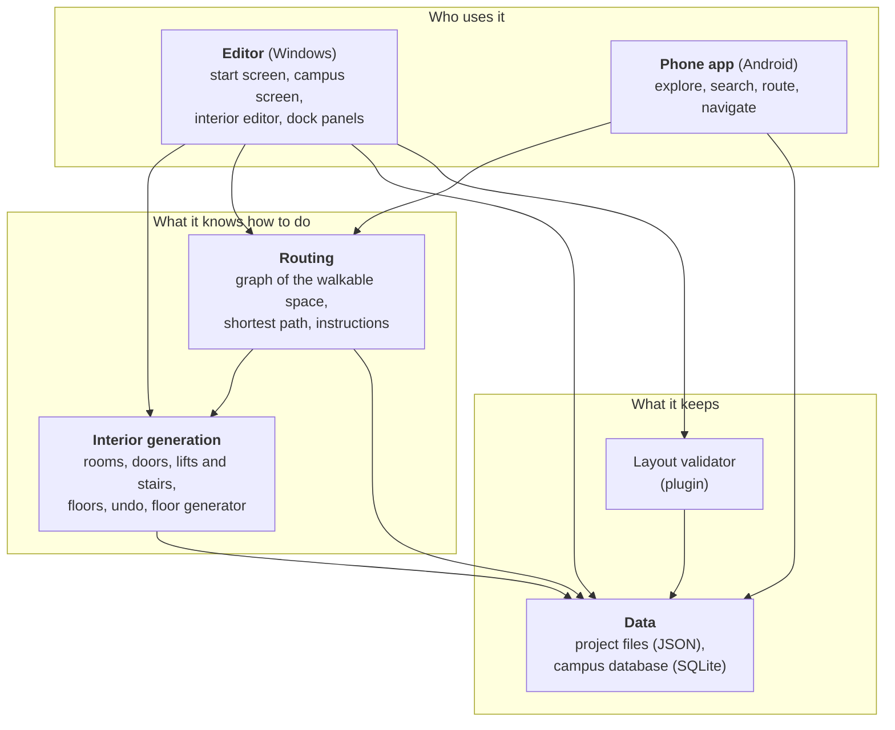
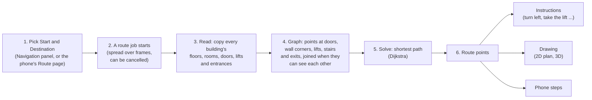

# System architecture

> Team **Pathfinder** · Project **InNavi** · v2.0, 2026-11-18. One page and two diagrams, written for T1 (PAT-169) by reading the code as
> someone who did not write it. The long version (every safeguard and delivery step) is [architecture-details.md](architecture-details.md).

## What InNavi is

InNavi shows the way **inside and between buildings**. An administrator draws or generates the buildings and their floors in a **Windows
editor**; students and visitors use the same data in an **Android phone app** that finds a route from where they are to a room. Both are one
Unreal Engine 5.8 program written in C++; there is no server, and everything is read from files.

## The five layers

An arrow means **uses**. The folder `InNavi/Source/InNavi/` is flat, so the layers are groups of files, not folders.

| Layer | What it is for | Main code |
|-------|----------------|-----------|
| **Editor** | The screens an administrator works in: choose a project, pick a building on the campus, edit its floors on a 2D plan or in 3D, plan a route. One controller holds the session (what is open, selected, unsaved). | `NavPlayerController`, `EditScreenWidget`, `InteriorScreenWidget`, dock system, `NavigationPanelWidget` |
| **Phone app** | The visitor's screens. They talk to a data source through one interface, so the same screens run on real project data or on the design team's prototype data. | `Mobile*Widget`, `IMobileNavSource` with `FMobileRealSource` and `FMobileMockSource` |
| **Data** | A project is a JSON file: buildings with outlines, floors, rooms, doors and lifts. The campus outlines come from a SQLite file made from OpenStreetMap. Saving, loading and the campus model live here. | `BuildingGenerator`, `ProjectFile`, `ProjectLibrary`, `Data/*.json`, `Data/map_extended.db` |
| **Interior generation** | Turns floors from the data into rooms, walls, doors and lifts that can be edited, checked and undone; can also fill an empty floor with a believable layout in one click. | `InteriorGenerator`, `InteriorRoom`, `FloorLayout`, `PolyBuilding` (the building shell) |
| **Routing** | Finds the shortest walkable way between two places, over floors and between buildings, and says it in words. Our own planner; Unreal's NavMesh is not used. | `NavigationRoutePlanner`, `NavigationInstructions`, `NavigationRouteVisualization` |

The **layout validator** is a separate plugin (`InNaviLayoutValidator`) that checks a project file for mistakes (overlapping rooms, doors that
point at a room that is not there). It works on plain data, so it needs nothing of the editor.

## One route search

- The job works on **copies** of the data, so editing while it runs cannot crash it; if the project changes under it, the search stops with a message.
- The graph is the expensive part, so it is **cached**; it is built again only when geometry, doors, lifts, entrances or the scale change.
- The editor and the phone use the **same planner and the same wording** (`NavigationInstructions`), so a route reads the same on both.
- Floors are numbered by **level**: 1 is the ground floor, 2, 3 ... go up, B1 is -1, and there is no level 0. A building may start on any level
  (a walkway on the third floor) or go below ground.

## Things that are true everywhere

- **Everything is data.** The campus and every floor are rebuilt from files when a project opens; there is no hand-made 3D model of the campus.
- **One unit rule.** Positions in the files are footprint units; times the project's scale they are centimetres in the world.
- **Edits go through `InteriorGenerator`.** Routing, validation and the phone only read. Every edit bumps a revision number, which is how old
  routes and reports are noticed and thrown away.
- **The phone has its own routing worlds.** Browsing another site on the phone never changes what is open in the editor.

## Where to read more

[architecture-details.md](architecture-details.md) (safeguards, delivery, who owns what) · [design/project-file-format.md](design/project-file-format.md)
(the JSON) · [design/interior-editor-guide.md](design/interior-editor-guide.md) (the editor) · [design/layout-validator.md](design/layout-validator.md)
· [performance.md](performance.md) · [toolchain-decision.md](toolchain-decision.md) (why these tools).

## Questions for the code owners

Things I could not answer from the code or the documents. They are for the people who wrote the parts; answers go here, then the question is removed.

1. **Campus database.** Who makes `Data/map_extended.db` from OpenStreetMap, with which script and settings? The script is not in this repository, so nobody can rebuild the file today.
2. **Two sources of truth for interiors.** `InteriorGenerator` holds one building's live interior while `BuildingGenerator` keeps the others as JSON. Which one wins when they disagree, and which bugs have this caused?
3. **Why the phone builds its own routing worlds** instead of reusing the editor's. Is it only to keep the editor's open building untouched, or also for speed?
4. **The first route is the slow one.** The graph is joined pair by pair and grows roughly with the square of its points. What is the biggest building or campus we promise to support, and is a spatial grid planned before M3?
5. **`NavPlayerController` is about 6,000 lines.** Which of its jobs (tools, selection, camera, audio, project file state, inspection) is meant to move out first?
6. **Buildings from the database have 5 floors, and the buildings around them are 9 m boxes.** Where do these defaults come from, and should a building without authored floors show a floor count at all?
7. **Is the plugin meant to be used outside InNavi?** The page says it works on plain data, but it still expects InNavi's project format. Who is the second user?
8. **Who owns the dock system and the shared panels** after the editor screens settle? The ownership table in the detailed page lists one person for the whole UI layer.
