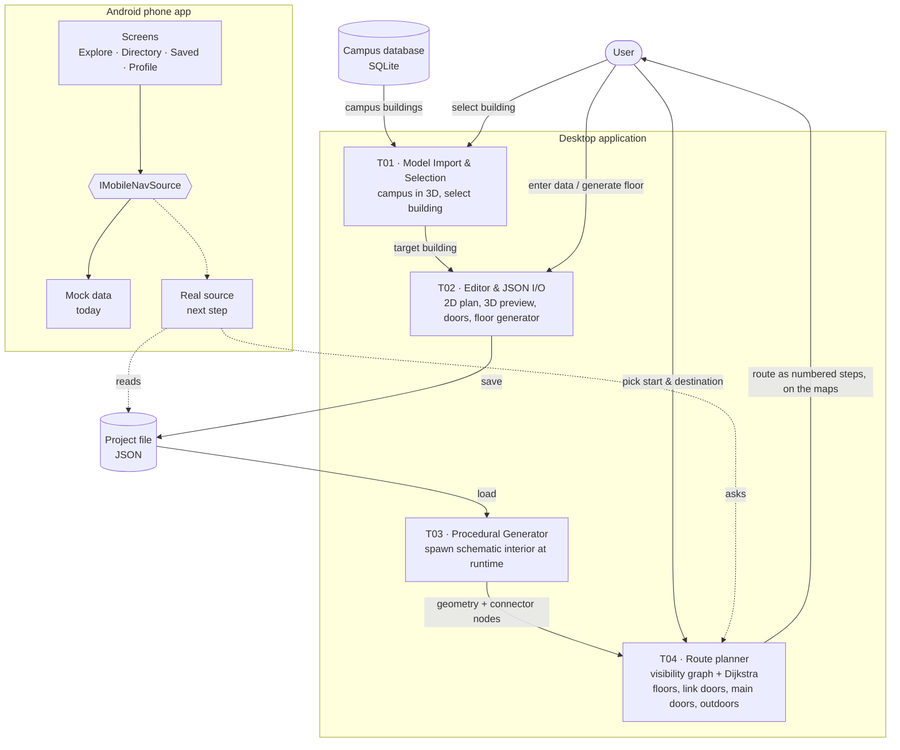

# System Architecture (v0.2)

> Team **Pathfinder** · Project **InNavi**
> Owned by: **Tech Lead.** This is the `Architecture` technical deliverable.
> v0.1 (2026-09-30) was the design before implementation. **v0.2 (2026-10-23)** brings it in line with what is built: the route
> planner turned out not to need a NavMesh, the editor gained a docking UI, doors between buildings and a floor generator, and the
> phone app exists. Sections 3-5 say what is there now; section 6 says which risks are gone.

---

## 1. Overview

InNavi is a **standalone Unreal Engine runtime application**. Everything happens at
runtime, inside the packaged application — not in the UE editor:

1. The user loads the campus model and selects a building.
2. The user enters interior data (rooms, floors, connectors, doors in the outer wall) through an in-app editor, or has a floor generated.
3. The data is saved/loaded as **JSON**.
4. The interior is **procedurally generated at runtime** from that JSON.
5. The user navigates: inside the building, across floors, between buildings (over link doors, or out through main doors and back in)
   and across the open ground between them.

The desktop application has two screens: the **exterior screen** (the campus in 3D, where a building is selected and routes
between buildings can be planned) and the **interior editor** (a building's floors in 2D, or a 3D preview, where interior data is
authored and routes inside it are planned). A separate **Android phone app** shows the same places and routes on a phone.

## 2. Technology stack

| Concern | Choice |
|---------|--------|
| Engine | Unreal Engine 5.8 |
| Core logic | C++ |
| UI & interaction | UMG, built entirely in pure C++ (`RebuildWidget()`), not the Blueprint Widget Designer |
| Data format | JSON (project files: buildings, interiors, doors), SQLite (real-world campus data - a second, additional loading path) |
| Route finding | Our own planner (`FNavigationRoutePlanner`): a visibility graph over the real wall, door and connector geometry, searched with Dijkstra. Not Unreal's NavMesh |
| Target platform | Windows desktop (the editor and the desktop app); Android phones (the phone app, 64-bit ARM, plus x86_64 for PC emulators) |

> Full rationale for each of these - and for libraries/plugins and AI tools, which
> this table leaves out - is recorded in `toolchain-decision.md`, not duplicated here.

## 3. System modules

The system is built from the four technical deliverables (see `deliverables.md`),
each mapped to one product feature, plus the phone app that reads their data:

| Module | Deliverable | Feature | Responsibility |
|--------|-------------|---------|----------------|
| Model Import & Selection | T01 | F01 | Import campus model; runtime click/ray-cast to select a building |
| Building Data Editor & JSON I/O | T02 | F02 | UMG editor to enter interior data (2D plan, 3D preview, doors, floor generator); dockable panels; save/load as JSON |
| Procedural Interior Generator | T03 | F03 | Read JSON; spawn schematic interior at runtime; record connectors as nodes |
| Indoor Navigation System | T04 | F04 | Plan routes over the generated geometry, across floors, between buildings and outdoors; show them as numbered steps and on the 2D and 3D maps |
| Phone app | T04 stretch | - | Android screens (Explore, Directory, Saved, Profile) over one data interface, `IMobileNavSource`; on made-up data until a real source is written |

Where they live in the code (`InNavi/Source/InNavi/`):

- **Editor screens and panels**: `EditScreenWidget` (exterior) and `InteriorScreenWidget` (interior) are built on the dock system
  (`DockLayoutModel`, `DockHostWidget`). Panels that appear on both screens are shared classes (`AudioPanelWidget`,
  `MapPanelWidget`, `DebugPanelWidget`, `NavigationDockPanelWidget`); see `design/ui-panels-guide.md`.
- **Data and generation**: `BuildingGenerator` (campus and project files), `InteriorGenerator` (rooms, doors, connectors, the doors
  in the outer wall, the floor generator on top of the pure-geometry `FloorLayout`).
- **Navigation**: `NavigationRoutePlanner` (the planner), `NavigationPanelWidget` (what is picked, the route and its steps; no UI of its own),
  `NavigationRouteVisualization` (the route on the 2D and 3D maps).
- **Phone app**: the `Mobile*` files; `MobileNavSource.h` is the interface, `MobileMockSource` the data it uses today.

## 4. Architecture diagram

## 5. Data flow

A single end-to-end cycle:

1. **Select** — user clicks a building (T01); the target building is passed on.
2. **Author** — user enters interior data in the UMG editor (T02): rooms, room types,
   floors, corridors, connectors (elevators/stairs/escalators) and doors in the outer wall
   (main doors, and link doors to the building next door) - or fills a floor with a generated layout.
3. **Persist** — T02 serializes the data to a **JSON** project file (and can reload it).
4. **Generate** — T03 reads the JSON and spawns the schematic interior at runtime
   (walls, doors, corridors, stairs). Elevators/doors are recorded as
   **input/output nodes** describing connections between floors.
5. **Navigate** — T04 builds a visibility graph from the geometry, the connector nodes and the doors in
   the outer walls, and searches it. The user picks a start and a destination (a room, a building's main door,
   or a point on the floor plan or the ground); T04 computes the route - including floor changes, link doors
   between buildings and the open ground - and shows it as numbered steps and on the maps.
   (e.g. L1 → elevator → L8 → target room; or building A → link door → building B → stairs → floor 3).

The connector nodes and doors produced in steps 2-4 are the contract between generation (T03) and
navigation (T04): the generator must emit them consistently for routing to work.

The phone app does not read any of this itself. Its screens ask `IMobileNavSource` for sites, buildings, places, floor plans and routes;
a real source will answer from the project file and from T04's planner (see `mobile-real-data-guide.md`).

## 6. Main technical risks

| Risk | Why it matters | Status |
|------|----------------|--------|
| School model import into UE | If the model does not import cleanly, nothing downstream works | **Resolved**: the SIT Punggol campus loads (footprints from `buildings.json`, the real map from the SQLite database) |
| Runtime dynamic NavMesh | Interior is generated at runtime, so the NavMesh must rebuild at runtime (not editor-baked) | **Avoided**: routing does not use a NavMesh; the planner reads the generated geometry directly each time |
| Cross-floor routing via NavLinks | Vertical connections are the hard part of the navigation | **Resolved**: connectors (`ConnectorGroupId`) join floors in the planner's graph; between buildings too (link doors) |
| Route-finding speed on big floors | Many walls make the visibility graph slow | **Managed**: a generated floor never has more than 24 rooms; a route is found in well under 100 ms in the test project |
| Mobile performance | Runtime generation + pathfinding may be heavy on mobile | **Checked** for the phone app on a Samsung Galaxy S24+ (steady 60 fps) and on emulators; the phone app does not yet run the planner, so this is open for real data |
| Real data on the phone | The project file has to reach the phone and the planner has to run there | **Open**: not tried yet (see `mobile-real-data-guide.md`) |

## 7. Component ownership

Ownership is tracked per deliverable in `deliverables.md`. As of 2026-10-23: T01–T03
(model import/selection, data editor & JSON, procedural interior generator) and the phone app
are owned by Yongqi; T04 (indoor navigation, including the doors between buildings and campus routing) by ws/jh.
